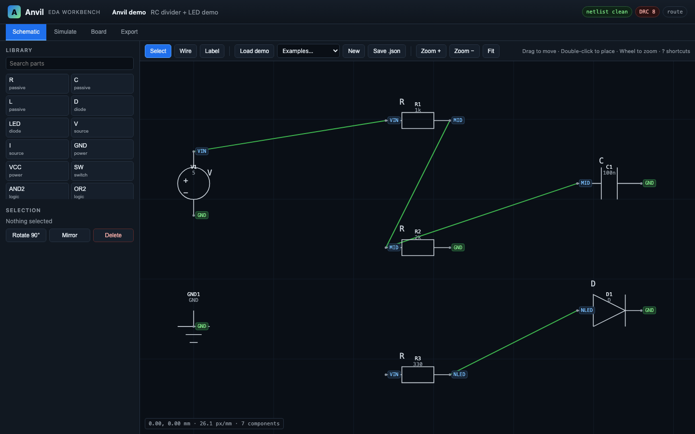
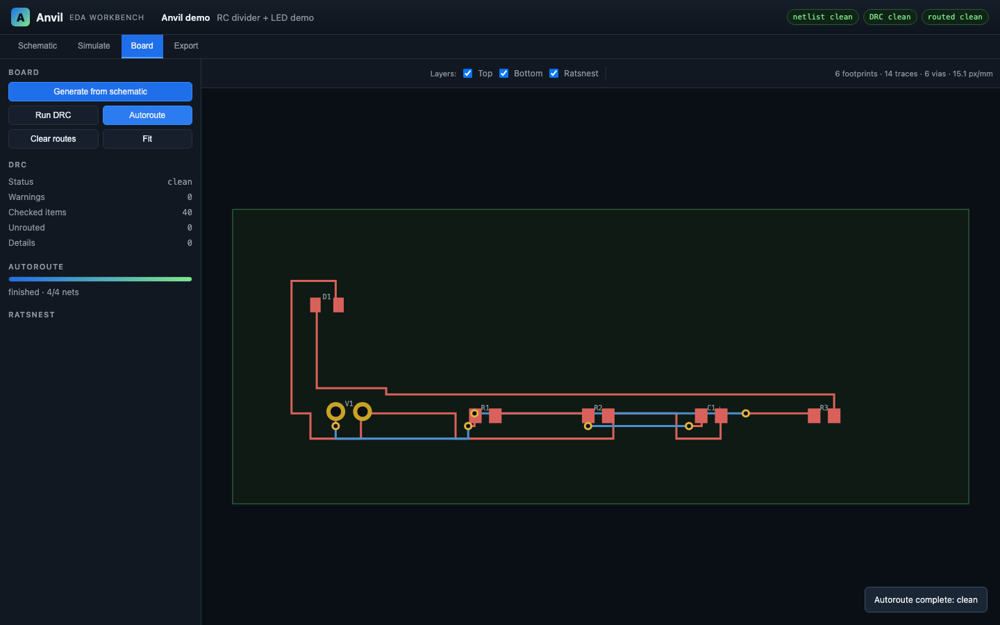

# Anvil

Anvil is a local browser EDA workbench: draw a schematic, simulate it, lay out a
board, run design rule checks, autoroute every trace, and export Gerber and
Excellon drill files. It runs entirely on your machine, binds only to
`127.0.0.1`, and ships as a single Rust binary with its UI compiled in.

No external crates. No CDN. No runtime downloads. Rust standard library only.



## Quick start

```sh
cargo run --release
```

The launcher starts the Studio on a random loopback port, opens the browser at a
URL containing a per-launch token, and keeps the server alive. The demo project
loads automatically.

```sh
cargo run --release -- --port 8787     # fixed port (still loopback only)
cargo run --release -- --no-browser    # server only
cargo run --release -- export <dir>    # batch export the routed demo
cargo run --release -- generate-examples
```

## What it does

- **Schematic capture** — components, pins, polyline wires, junctions, local /
  global / power labels, buses, and an original library of passives, diodes,
  sources, a switch, logic gates, a D flip-flop and connectors.
- **Netlist extraction** — exact integer geometry, union-find connectivity,
  label merging, bus member expansion, deterministic naming and diagnostics.
- **Simulation** — modified nodal analysis, dense LU with partial pivoting,
  Newton iteration for Shockley diodes with series resistance, DC operating
  point, backward-Euler and trapezoidal transient analysis, and an event-driven
  digital engine for gates and flip-flops. Tested against analytic solutions.
- **PCB** — board outline, 2 or 4 copper layers, footprints, SMD and through-hole
  pads, traces, vias and ratsnest.
- **DRC** — structure, clearance, track width, drill, annular ring, shorts,
  board-edge and unrouted checks, with spatial indexing and deterministic
  reports.
- **Autorouter** — deterministic grid A* on two layers with vias, MST ordering,
  rip-up/retry, and a DRC gate that never reports a clean route it did not verify.
- **Export** — Gerber RS-274X copper, silkscreen and outline; Excellon drill; a
  built-in Gerber parser and rasterizer for verification; PNG previews.
- **Studio** — original HTML/CSS/JS served from the binary: schematic canvas,
  simulation plots, board canvas, DRC panel, autoroute progress over SSE and
  Gerber preview. No external fonts, scripts or assets.



## Workspace

| Crate | Purpose |
|---|---|
| `anvil-core` | schematic, library, netlist, simulation |
| `anvil-pcb` | board model, footprints, DRC, autorouter, board generation |
| `anvil-export` | Gerber, Excellon, parser, rasterizer, PNG |
| `anvil-studio` | JSON, HTTP/SSE, API, project model, embedded assets |
| `anvil` (root) | launcher and batch tools |
| `bench` | standard-library benchmarks |
| `fuzz` | deterministic malformed-input harness |

## Verification

| Suite | What it proves |
|---|---|
| `cargo test` | 100+ unit and integration tests across all crates |
| 500 reference netlists | linear MNA matches an independent solver |
| 40 analytic circuits | dividers, Millman, parallel, diodes, RC within 0.1% |
| 20 generated boards | every net routes with zero DRC errors |
| Gerber/drill round trips | exports re-parse and rasterize identically |
| 1,000 malformed inputs | no panics; clean errors |
| Playwright | draw → simulate → DRC → autoroute → preview |
| `anvil-fuzz 2000` | 0 panics over parser/project/edit/netlist campaigns |

Measured release benchmarks (single thread, development machine):

| Operation | Time |
|---|---:|
| Netlist extraction (demo) | 0.026 ms |
| DC operating point (demo) | 0.002 ms |
| Transient, 2,000 steps (demo) | 1.71 ms |
| Transient, 1,000 steps (20-node RC) | 4.34 ms |
| Autoroute, 10-net board | 2.8–4.3 ms |
| DRC, routed generated board | 0.273 ms |
| Gerber write / parse | 0.030 / 0.010 ms |
| Rasterize at 10 px/mm | 0.115 ms |

Line coverage is about **80%** overall (`cargo llvm-cov --workspace
--summary-only`); see `FINAL_REPORT.md`.

## Documentation

- [Architecture](docs/ARCHITECTURE.md)
- [Simulation](docs/SIMULATION.md)
- [Autorouter](docs/ROUTER.md)
- [DRC](docs/DRC.md)
- [Gerber and drill](docs/GERBER.md)
- [Studio](docs/STUDIO.md)
- [Testing](docs/TESTING.md)
- [Examples](examples/README.md)
- [Limitations](LIMITATIONS.md)
- [Final report](FINAL_REPORT.md)

## Soundness and determinism

- All geometry is integer nanometres; connectivity and DRC are exact.
- All randomness is a documented seeded xorshift generator.
- Every parser has hard limits on bytes, tokens, nesting and element counts.
- Malformed input returns `Result`, never panics; tests and fuzz enforce this.
- Manually edited schematics invalidate the board, so layout cannot silently
  drift from the netlist.
- Simulation and DRC report real results or errors. Nothing is fabricated.

## License

MIT. See [LICENSE](LICENSE). No third-party code is vendored.

This project is original work. It is not a database, CRDT, crash-analysis or
observability product, and it has no CI/CD configuration.
